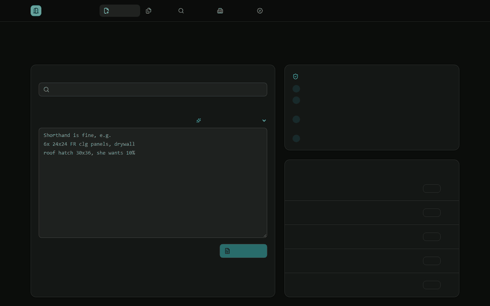
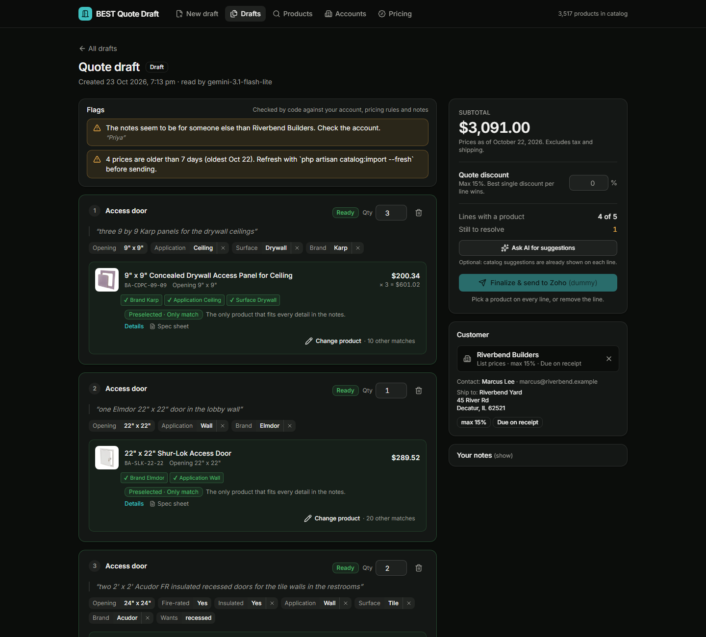
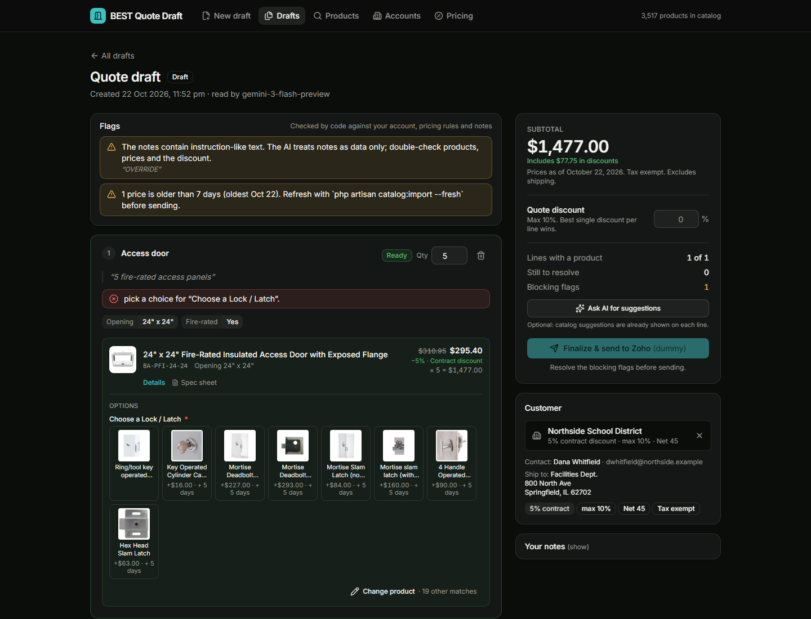
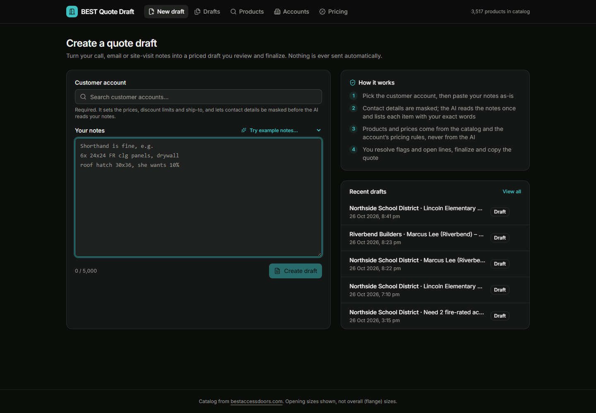
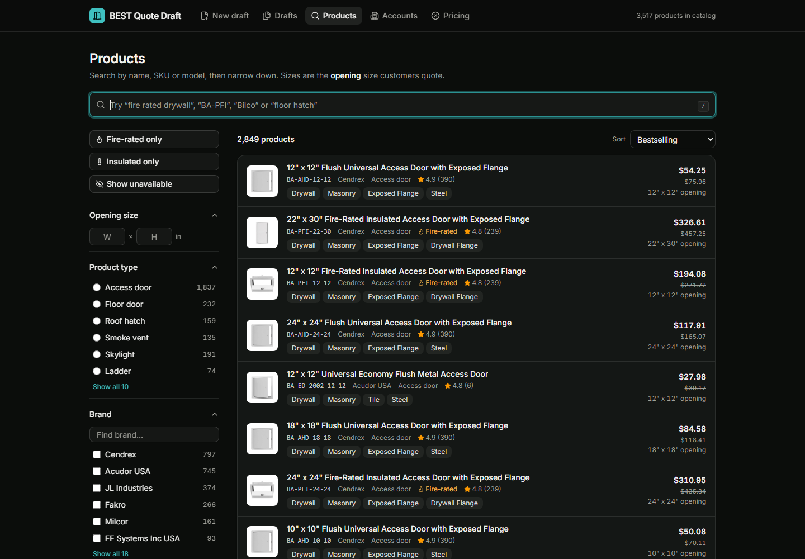
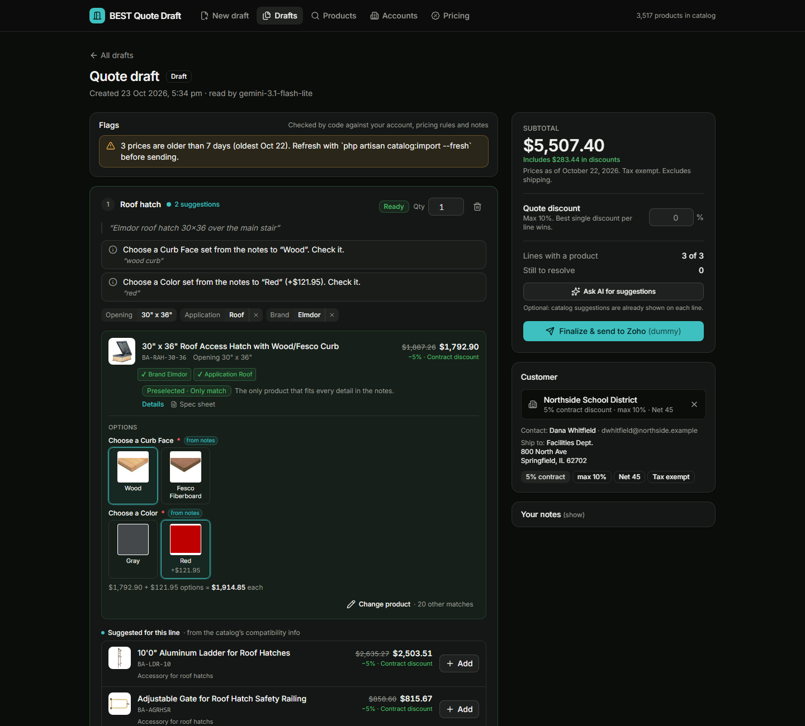
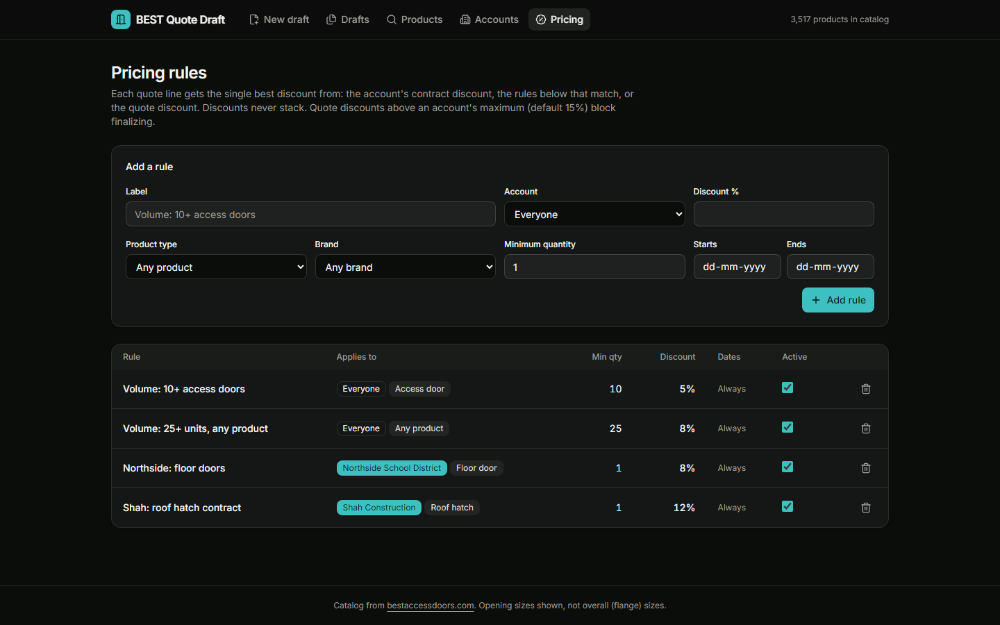
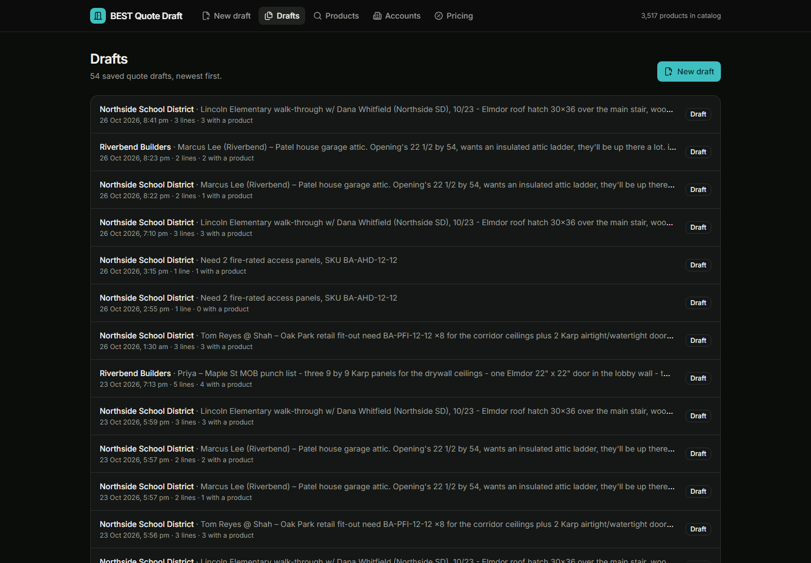
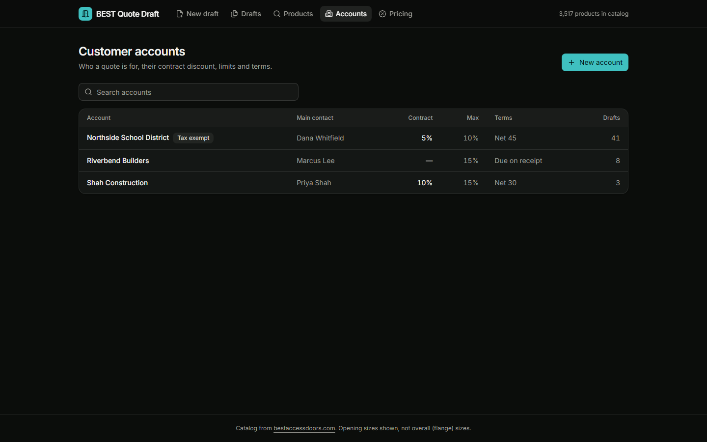

# BEST Quote Draft

**Turn a salesperson's messy call, email or site-visit notes into a priced, reviewable quote, using a real product catalog.**

An internal sales tool built around the catalog of [Best Access Doors](https://www.bestaccessdoors.com) (access doors, roof hatches, floor doors, smoke vents, skylights and attic ladders). Paste rough notes like *"6x 24x24 FR clg panels, drywall, roof hatch 30x36, she wants 10%"*, pick the customer, and get a draft quote with matched products, correct account pricing and flags for anything a human should double-check.




---

## Why I built this

Job interviews love hypothetical questions: *"How would you design a quoting system?"*, *"How would you use AI safely in a sales workflow?"* I wanted to answer those with something that actually runs.

So I picked a real business with a real catalog and a real, everyday problem. A company selling thousands of building products gets quote requests as phone calls, half-written emails and site-walk notes. Turning those into an accurate quote means decoding shorthand (*FR*, *clg*, *2'x2'*), finding the right product among 3,500+ SKUs, applying the right customer's discount, and not making anything up. That's slow, repetitive and easy to get wrong, which makes it a good place for AI as long as the AI isn't trusted with the parts that matter.

The result is a working tool. It imports the live public catalog, handles the messy input real salespeople write, and is opinionated about where AI belongs: **the model only reads the notes. Code does the matching, the pricing and the safety checks.**

---

## How it works

```
 notes ─► redact PII ─► ONE LLM call ─► validate every value ─► match in Postgres ─► price in PHP ─► flags ─► human review ─► Zoho CRM
          (Redactor)    (QuoteExtractor)  (DraftValidator)      (ProductMatcher)    (PriceCalculator) (DraftFlags)
```

1. **The salesperson picks the customer account first.** Its contacts are known exactly, so names, emails and phone numbers are masked before anything leaves the server.
2. **One LLM call** (Gemini via the [Laravel AI SDK](https://github.com/laravel/ai)) turns the redacted notes into fixed JSON: each requested item, plus discount, delivery and internal remarks. Every value must come with the **exact quote** from the notes that supports it.
3. **Code validates that JSON before trusting it.** A spec whose quote isn't in the notes, whose value is outside the known vocabulary, or whose size numbers aren't in its quote gets dropped, and the tool asks the human instead of guessing.
4. **Postgres finds the products.** It filters hard on type, opening size (either orientation) and fire rating, then judges each remaining detail per product as *yes / via an option / unknown / no* using store tags, parsed product pages and product options. If several products fit equally well, none is preselected. The salesperson picks.
5. **PHP does the money**, in integer cents: list price, the account's contract discount, price rules and the quote discount. The single best discount wins and discounts never stack, so every price has exactly one reason the reviewer can read.
6. **Guardrail flags** are computed by code, never by the AI. Examples: notes that look like they're for a different customer, prompt-injection-like text, stale prices, discount requests above the account's limit, missing required options. Blocking flags disable *Finalize* until they're resolved.
7. **Finalize & send** builds the exact Zoho CRM *Insert Quote* request from trusted data only. It runs in dummy mode by default, so nothing is ever sent automatically.

---

## Screenshots

| | |
|---|---|
| **Draft review**: matched products, evidence quotes, account pricing<br> | **Prompt-injection guard**: instruction-like text in notes is flagged and treated as data only<br> |
| **New draft**: account-first, then paste notes as-is<br> | **Product search**: Postgres full-text search with facets over 3,517 products<br> |
| **Roof hatch draft** with options and accessories<br> | **Pricing rules**: volume and per-account discounts<br> |

<details>
<summary>More screenshots</summary>




</details>

All customers, contacts and addresses shown are fictional demo data (`.example` domains).

---

## Features

- **Notes → structured items with evidence.** Handles shorthand, feet/inch conversions, multi-item emails with signatures, named SKUs and brands.
- **PII redaction** before any AI call, using the account's known contacts plus regexes for other emails and phone numbers.
- **Catalog matching that never guesses.** Each detail is judged per product, ties are left to the human, and "unknown" ranks below "confirmed" instead of being treated as a match or a miss.
- **Product options and accessories.** Required options are surfaced (e.g. lock/latch choice with price and lead time). Accessories tied to the chosen product are suggested, and wrong-size kits are never offered.
- **Account-aware pricing** with contract discounts, volume rules, max-discount limits, tax-exempt accounts and payment terms.
- **Guardrail flags** at three levels: blocking, warning, info.
- **Model fallback.** One retry on a fallback model when the default is busy or rate limited, all within a fixed request time budget.
- **Optional second AI pass** (`DRAFT_AI_SUGGESTIONS`) that suggests variants and add-ons using a SKU acronym dictionary. It's off by default, behind an env flag.
- **Catalog pipeline.** Imports from the store's public site search (Searchspring), then fetches and parses product pages for specs, options and compatible accessories. It respects `robots.txt` (including `Crawl-delay`) and throttles requests.
- **Zoho CRM handoff** that builds the real API v8 request, with a dummy sender by default.
- **An eval harness** (`php artisan drafts:eval`) that runs 21 hand-written note scenarios against the real LLM and scores the extraction.

---

## Tech stack

| Layer | Choice |
|---|---|
| Backend | Laravel 13, PHP 8.4 |
| Frontend | React 19 + TypeScript, Inertia.js v3, Tailwind CSS v4, shadcn/ui |
| Database | PostgreSQL 17 (array columns, native full-text search via Laravel Scout) |
| AI | Laravel AI SDK → Google Gemini (`gemini-3.1-flash-lite`, fallback `gemini-3-flash-preview`) |
| Tests | Pest, 162 tests / 1,040 assertions, AI calls faked |
| Integrations | Searchspring (catalog), Zoho CRM (quotes) |

---

## Running it locally

**Requirements:** PHP 8.4, Composer, Node 22+, PostgreSQL 15+, and a [Gemini API key](https://aistudio.google.com/apikey).

```bash
git clone https://github.com/sakshamgorey/quote-draft.git
cd quote-draft
cp .env.example .env          # then set DB_* and GEMINI_API_KEY
composer install
npm install
php artisan key:generate
php artisan migrate --seed     # demo accounts + pricing rules
php artisan catalog:import     # pulls the public catalog (throttled)
npm run build
php artisan serve
```

Optional: enrich products with specs and options from their pages.

```bash
php artisan catalog:fetch-pages && php artisan catalog:parse-pages
```

### Tests

```bash
php artisan test --compact
```

Tests use a Postgres database (`DB_DATABASE=bestdraft_test` in `phpunit.xml`) and never call the real AI. To score the extractor against the real model (this costs API calls):

```bash
php artisan drafts:eval
```

---

## Project structure

```
app/
  Ai/Agents/              QuoteExtractor (the one LLM call), SuggestionAdvisor (optional)
  Services/Drafts/        Redactor, DraftValidator, ProductMatcher, ProductFit, DraftFlags, ...
  Services/Pricing/       PriceCalculator
  Services/Catalog/       FacetTagger, ProductNormalizer
  Services/ProductPages/  PageFetcher, PageParser, RobotsRules
  Services/Searchspring/  catalog API client
  Services/Zoho/          Zoho CRM quote request builder
resources/js/pages/       drafts, products, accounts, pricing (React + Inertia)
tests/Feature/            Pest feature tests + fixtures
```

Design notes from building the matcher: [PRODUCT-MATCHING-RESEARCH.md](PRODUCT-MATCHING-RESEARCH.md) and [ATTRIBUTE-MATCHING-RULES.md](ATTRIBUTE-MATCHING-RULES.md).

---

## Notes

- This is an independent portfolio project. It is **not affiliated with or endorsed by Best Access Doors**. Product data comes from their public website at import time and is not included in this repository.
- The full SKU dictionary built from the catalog is kept private. [`SKU-ACRONYM-DICTIONARY.sample.md`](SKU-ACRONYM-DICTIONARY.sample.md) is a small excerpt with the same format.

---

Built by [Saksham Gorey](https://github.com/sakshamgorey).
